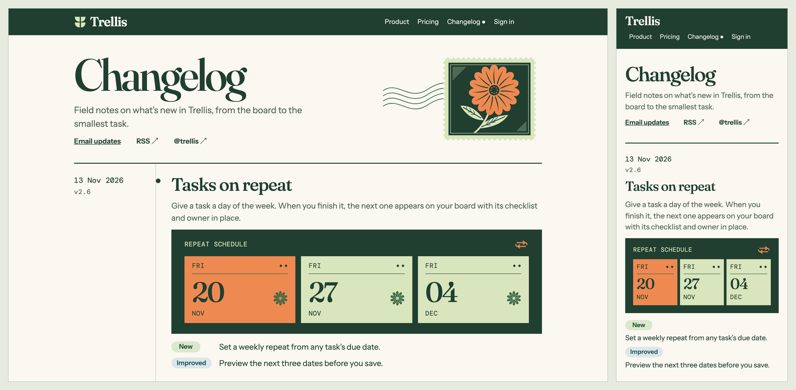
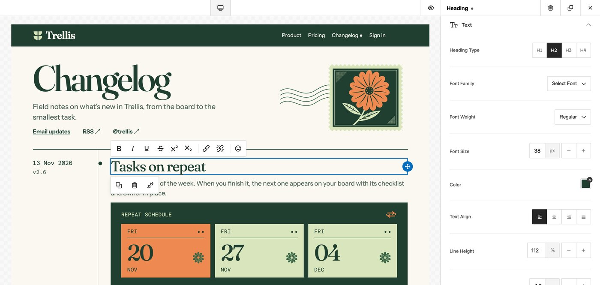
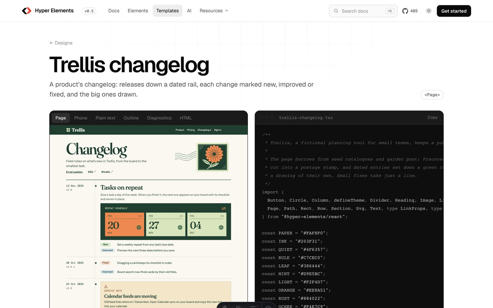

# Trellis changelog

**A Hyper Elements template for a product's changelog page: releases down a dated rail, each change marked new,
improved or fixed, and the big ones drawn.**



Add a release by adding one object to a values file. The template checks it, puts it in date order and renders a static page. The same history supplies an RSS feed, so each subscriber gets the same release notes as a visitor.

Trellis is a fictional planning tool for small teams. Its releases are invented.

## Use it

Install the locked dependencies and render the gallery example. The HTML and a plain-text edition land in `out/`. To reproduce the screenshots locally, install Chromium with `npx playwright install chromium` first.

```sh
npm ci
npm run build
npx tsx scripts/rss.ts
```

The feed command reads `designs/changelog.values.json` and writes `out/rss.xml`. Serve the page at `changelog` under your `site` URL and the feed at the URL in `rss`. Clicking a date gives you the same permalink that subscribers receive.

To render the component in a build script, pass it a release list. Omitted props use the gallery example.

```tsx
import { render } from "@hyper-elements/react";
import TrellisChangelog from "./src/trellis-changelog";

const { html } = await render(
  <TrellisChangelog
    intro="Changes from the team that looks after Trellis boards."
    releases={[{
      type: "small", date: "2026-11-18", version: "2.6.1",
      changes: [{ kind: "Fixed", text: "Board exports keep the column order." }],
    }]}
  />
);
```

For a data-only workflow, copy the shorter history and edit its `values`. Set `site`, `product`, the optional `wordmark`, navigation and follow links, then add your releases. The CLI can change individual fields too. These commands write `out/designs/team.html` and generate the matching `out/rss.xml`.

```sh
npx hyper-elements describe templates/changelog.tsx
cp designs/library-preview.values.json designs/team.values.json
npx hyper-elements design set designs/team.values.json 'intro=Changes to our team board library.'
npx hyper-elements check designs/team.values.json
npx hyper-elements render designs/team.values.json
npx tsx scripts/rss.ts designs/team.values.json
```

## One object, one release

<table>
<tr><th>In the values file</th><th>On the page</th></tr>
<tr><td><pre>{
  "type": "small",
  "date": "2026-09-11",
  "version": "2.3.1",
  "changes": [{
    "kind": "Fixed",
    "text": "Long board names wrap in the project switcher."
  }]
}</pre></td><td></td></tr>
</table>

## How Hyper Elements is used

The `Page` has one `defineTheme` for the heading scale, colors, typefaces and three pill styles. Above 870px a dot on the rail lines up with each release date. On phones the date sits above the entry, each label sits above its change, and the navigation sits below the wordmark. One `Menu` holds up to five links and marks the changelog with a dot.

The calendula stamp is inline `Svg`. Rotated petal paths form the flower, and circles cut the perforations around its edge. The weekly illustration adds seven, fourteen and twenty-one days to the release date in UTC. The board illustration draws two copies of a three-column board. Both ship with the component.

The template takes one to 24 release blocks. A feature has a date, version, headline, paragraph and one to eight labeled changes. It can show a weekly drawing, a board drawing, a product screenshot or just the copy. A small release needs a date, version and changes. A service notice gets a bordered panel for the headline and details, with a version only when supplied.

```tsx
kind: prop.choice(["New", "Improved", "Fixed"], {
  label: "Change kind", required: true,
})
```

For a screenshot, set `screenshot` to `{ "src": "…", "width": 1200, "height": 800 }` using the image’s URL and actual pixel dimensions. Give it a short `screenshotAlt` description. The `field.image` accepts PNG, JPEG and WebP at least 800px wide, with a width-to-height ratio from 1 to 2.5. The framed image keeps its aspect ratio and takes precedence over a drawing.

The version pattern accepts `2.6` and `2.6.1`. The rules check the page title, language, heading order, contrast, alternate text, link text and layout overflow. The template derives its allowed hosts from `site`, `rss` and `social` and checks navigation and signup destinations against them. The template and its gallery component are the two trusted modules listed in `package.json`.

## Edit it in Unlayer's builder

Run `npm run design-json` and pass the contents of `out/trellis-changelog.design.json` to `editor.loadDesign(design)` in a web-mode Unlayer editor. Select a headline to edit it as a Heading. Dates, versions, summaries, colored labels and individual change sentences are Paragraph tools. The navigation is a Menu, the rules are Dividers, and the archive link is a Button. A supplied screenshot becomes an Image tool.

The sprig, stamp, notice icon and two feature illustrations export as five movable HTML blocks. The export writes theme values onto the individual tools. The page’s 870px breakpoint and inline-link hover treatments apply in the rendered page. Builder edits affect the exported design. Edit the values file to update both the page and RSS.

While editing, the empty rail cells beside each change show the editor's "No content here" placeholder; they render empty.



## Views

The full history covers six releases from 11 September to 13 November. The shorter Shelfmark example uses its own wordmark and follow hosts. It opens with a versionless service note, followed by a feature without artwork. [Full desktop view](docs/desktop.png) · [Full phone view](docs/phone.png) · [Six-release history](designs/changelog.values.json) · [Two-release history](designs/library-preview.values.json)

## Checks

| Command | Result |
| --- | --- |
| `npm run build` | `src/trellis-changelog.tsx (Page): 0 errors and warnings, 0 notes` |
| `npx hyper-elements check src templates designs` | 4 designs, 0 errors, 0 warnings, 0 skipped |
| `npx hyper-elements render designs` | 2 designs, 0 errors, 0 warnings, 0 skipped |
| `npx tsc --noEmit` | Exit 0, no output |
| `npm run design-json` | 5 artwork blocks as HTML, 4 notes about styling |
| `npx tsx scripts/rss.ts` | 6 RSS items, newest first |

## Add it to the gallery

Copy [`src/trellis-changelog.tsx`](src/trellis-changelog.tsx) to `apps/website/examples/templates/`. It has the gallery's `meta` and renders with no props.

We tested exactly that: the file, unchanged, in a local clone of the Hyper Elements site, through the site's own
generator (`pnpm generate`) and dev server. It rendered with no diagnostics, and appears on `/templates/trellis-changelog` beside the
official designs:



## License

The code and original artwork are MIT licensed. [MIT license](LICENSE)

Fraunces, Instrument Sans and DM Mono are served by Google Fonts under the SIL Open Font License. [Fraunces](https://github.com/google/fonts/blob/main/ofl/fraunces/OFL.txt) · [Instrument Sans](https://github.com/google/fonts/blob/main/ofl/instrumentsans/OFL.txt) · [DM Mono](https://github.com/google/fonts/blob/main/ofl/dmmono/OFL.txt)
