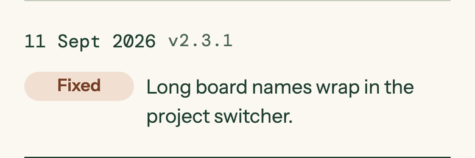

# Trellis changelog

**A Hyper Elements template for a product's changelog page: releases down a dated rail, each change marked new,
improved or fixed, and the big ones drawn.**


Every product team keeps a changelog, and most either hand-write HTML for each release or embed a third-party
widget. This one is a changelog as data: the releases are a list of blocks in a values file, the template decides
how each kind of entry looks and checks every one of them, and the page renders at build time with no client-side
code. Adding a release is adding one object to the history.

Trellis is a fictional planning tool for small teams; its releases are invented.

## Use it

Install the locked dependencies and render the gallery example. The HTML and a plain-text edition land in `out/`. To reproduce the screenshots locally, install Chromium with `npx playwright install chromium` first.

```sh
npm ci
npm run build
```

To render the component in a build script, pass it a release list. Omitted props use the gallery example.

```tsx
import { render } from "@hyper-elements/react";
import TrellisChangelog from "./src/trellis-changelog";

const { html } = await render(
  <TrellisChangelog
    intro="Changes from the team that looks after Trellis boards."
    releases={[{
      type: "small", date: "2026-11-18", version: "2.6.1",
      changes: [{ kind: "Fixed", text: "Board exports keep the column order." }],
    }]}
  />
);
```

For a data-only workflow, copy the shorter history and edit its `values.releases` array. The CLI can change individual fields too. This example writes `out/designs/team.html`.

```sh
npx hyper-elements describe templates/changelog.tsx
cp designs/library-preview.values.json designs/team.values.json
npx hyper-elements design set designs/team.values.json 'intro=Changes to our team board library.'
npx hyper-elements check designs/team.values.json
npx hyper-elements render designs/team.values.json
```

## One object, one release

<table>
<tr><th>In the values file</th><th>On the page</th></tr>
<tr><td><pre>{
  "type": "small",
  "date": "2026-09-11",
  "version": "2.3.1",
  "changes": [{
    "kind": "Fixed",
    "text": "Long board names wrap in the project switcher."
  }]
}</pre></td><td></td></tr>
</table>

## How Hyper Elements is used

The `Page` has one `defineTheme` for the heading scale, colors, typefaces and three named pill treatments. Each release is a `Row`. Above 870px the date and version sit beside the note on a ruled rail. At narrower widths the same row stacks. A `Menu` holds navigation links, and the current link carries `aria-current="page"`.

The calendula stamp is inline `Svg`. Rotated petal paths form the flower, and circles cut the perforations around its edge. The weekly illustration adds seven, fourteen and twenty-one days to the release date in UTC. The board illustration draws a stack of three-column boards. Both travel with the component.

The template accepts one to 24 release blocks. A feature takes a headline, paragraph, drawing and one to eight changes. A small release needs only the date, version and changes. A notice takes a headline and an action or deadline. Each change has a written label.

```tsx
kind: prop.choice(["New", "Improved", "Fixed"], {
  label: "Change kind", required: true,
})
```

The version pattern accepts `2.6` and `2.6.1`. The rules check the page title, language, heading order, contrast, alternate text, link text and layout overflow. Navigation and follow links use the fictional host `trellis.example`. The template and its gallery component are the two trusted modules listed in `package.json`.

## Views

The full history covers six releases from 11 September to 13 November. The shorter example opens with a service notice and contains just two entries. [Full desktop view](docs/desktop.png) · [Full phone view](docs/phone.png) · [Six-release history](designs/changelog.values.json) · [Two-release history](designs/library-preview.values.json)

## Checks

| Command | Result |
| --- | --- |
| `npm run build` | `src/trellis-changelog.tsx (Page): 0 errors and warnings, 0 notes` |
| `npx hyper-elements check templates designs` | `3 designs: 0 errors, 0 warnings, 0 skipped` |
| `npx hyper-elements render designs` | `2 designs: 0 errors, 0 warnings, 0 skipped` |
| `npx tsc --noEmit` | Exit 0, no output |

## Add it to the gallery

Copy `src/trellis-changelog.tsx` to `apps/website/examples/templates/`. It exports the gallery’s `meta` and renders with no props.

## License

The code and original artwork are MIT licensed. [MIT license](LICENSE)

Fraunces, Instrument Sans and DM Mono are served by Google Fonts under the SIL Open Font License. [Fraunces](https://github.com/google/fonts/blob/main/ofl/fraunces/OFL.txt) · [Instrument Sans](https://github.com/google/fonts/blob/main/ofl/instrumentsans/OFL.txt) · [DM Mono](https://github.com/google/fonts/blob/main/ofl/dmmono/OFL.txt)
